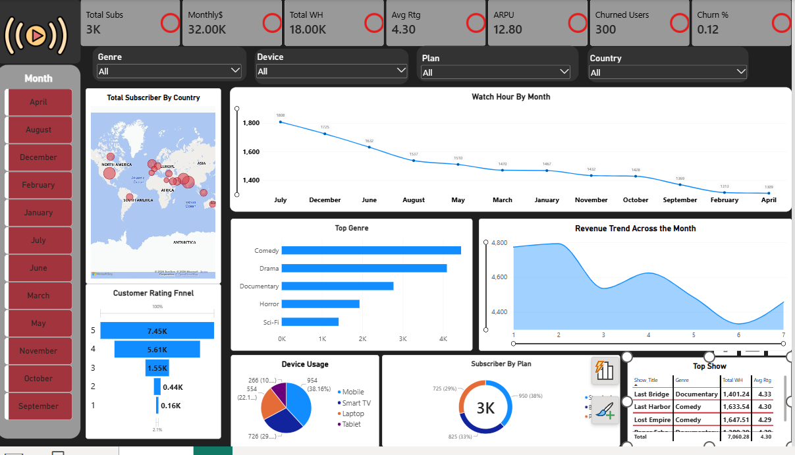

# 🎬 Streaming Platform Analytics Dashboard

An interactive **Power BI dashboard** that analyzes subscriber behavior, viewing patterns, revenue, and churn for a video streaming platform. It gives a complete, filterable view of business performance in a single page.



---

## 📌 Table of Contents
- [Project Overview](#-project-overview)
- [Business Objectives](#-business-objectives)
- [Key Performance Indicators](#-key-performance-indicators-kpis)
- [Dashboard Components](#-dashboard-components)
- [Interactive Filters](#-interactive-filters)
- [Key Insights](#-key-insights)
- [Tech Stack](#-tech-stack)
- [Project Structure](#-project-structure)
- [Future Enhancements](#-future-enhancements)
- [Author](#-author)

---

## 📖 Project Overview

Streaming businesses depend on subscriber growth, engagement, and retention. This dashboard consolidates those metrics so stakeholders can monitor performance, spot trends, and make data-driven decisions quickly.

## 🎯 Business Objectives

- Track subscriber base, revenue, and engagement in one place
- Understand which genres, shows, devices, and plans drive the most value
- Monitor churn and identify retention opportunities
- Analyze geographic distribution of subscribers
- Observe month-over-month trends in watch hours and revenue

## 📊 Key Performance Indicators (KPIs)

| KPI | Value | Description |
|---|---|---|
| **Total Subs** | 3K | Total number of subscribers |
| **Monthly $** | 32.00K | Monthly revenue |
| **Total WH** | 18.00K | Total watch hours |
| **Avg Rtg** | 4.30 | Average customer rating |
| **ARPU** | 12.80 | Average revenue per user |
| **Churned Users** | 300 | Subscribers who left the platform |
| **Churn %** | 0.12 | Churn rate |

## 🧩 Dashboard Components

| Visual | Purpose |
|---|---|
| **Total Subscriber by Country** (Map) | Geographic distribution of subscribers |
| **Watch Hour by Month** (Line chart) | Monthly engagement trend |
| **Top Genre** (Bar chart) | Genre popularity: Comedy, Drama, Documentary, Horror, Sci-Fi |
| **Revenue Trend Across the Month** (Area chart) | Revenue movement over the period |
| **Customer Rating Funnel** | Distribution of ratings from 5★ to 1★ |
| **Device Usage** (Pie chart) | Share of Mobile, Smart TV, Laptop, and Tablet |
| **Subscriber by Plan** (Donut chart) | Subscriber split across subscription plans |
| **Top Show** (Table) | Top shows by watch hours and average rating |

## 🎛️ Interactive Filters

All visuals respond dynamically to the following slicers:

- **Month**
- **Genre**
- **Device**
- **Plan**
- **Country**

## 💡 Key Insights

- **Comedy** is the most-watched genre, followed by **Drama** and **Documentary**.
- **Mobile** is the leading device (~38% of usage), followed by Smart TV.
- Customer satisfaction is strong: the majority of ratings are **4★ and 5★** (7.45K and 5.61K respectively).
- Subscribers are fairly evenly split across the three plans (38% / 33% / 29%).
- **Watch hours show a declining trend** across the months, an area to investigate for engagement strategies.
- Top shows by watch hours include *Lost Empire*, *Last Harbor*, and *Last Bridge*, each with an average rating above 4.2.

## 🛠️ Tech Stack

- **Power BI Desktop**: data modeling, DAX measures, and visualization
- **DAX**: calculated measures (ARPU, Churn %, etc.)
- **Power Query**: data cleaning and transformation
- **Power BI Template (.pbit)**: shareable template file of the report

## 📁 Project Structure

```
├── stream.pbit           # Power BI template file (report + data model)
├── stream.png            # Dashboard preview screenshot
└── README.md             # Project documentation
```

## 🔮 Future Enhancements

- Add cohort-based retention analysis
- Include churn-reason breakdown
- Add year-over-year comparison
- Forecast revenue and subscriber growth
- Publish to Power BI Service with scheduled refresh

## 👤 Author

**Your Name**
- GitHub: [@your-username](https://github.com/your-username)
- LinkedIn: [Your Profile](https://linkedin.com/in/your-profile)

---

⭐ If you found this project useful, consider giving it a star!
